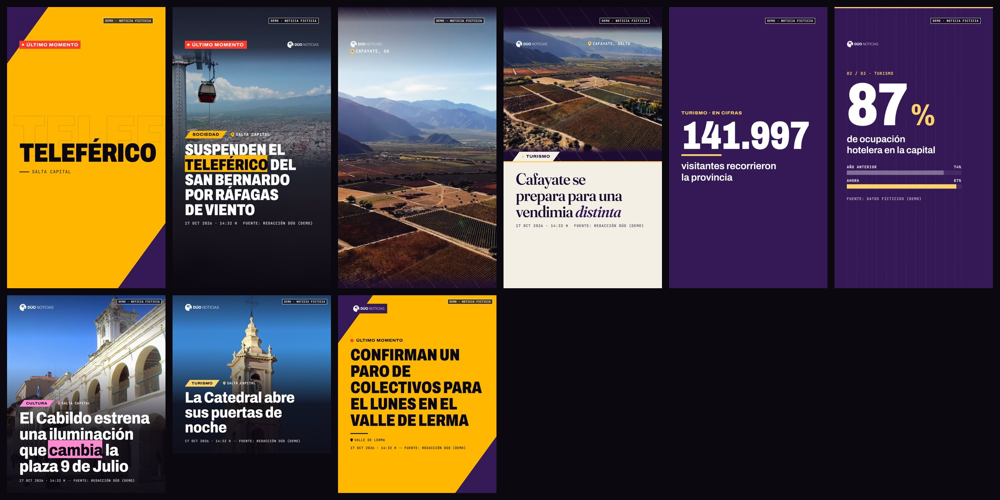

# Dúo Motion: sistema audiovisual de Dúo Noticias

Motor de diseño programático para posts y videos: Remotion + React + TypeScript, más un panel editorial en Next.js. El autopublicador 24/7 (Python, en la raíz del repo) lo usa para todas las piezas que publica en Instagram y Facebook.

- **4 plantillas**:
  - Breaking News (reel);
  - Editorial News (reel);
  - Data Explainer (reel);
  - Static Editorial Post (post, carrusel y story).
- **3 ganchos visuales** para los primeros segundos: impacto tipográfico, revelación fotográfica y dato protagonista.
- **3 formatos** que se recalculan, no se recortan: 1080×1920, 1080×1350 y 1080×1080.
- **Animación determinística**: todo depende del frame (springs y curvas), nunca de transiciones CSS ni del reloj.


- **Exportación real**: MP4 (H.264 + AAC, 30 fps, siempre con pista de audio) y JPG/PNG.

## Requisitos

- Node 20.19+ o 22.13+ (en FERNANDO está instalado Node 22). Remotion descarga su Chrome headless la primera vez que renderiza.
- `npm install` dentro de `motion/`.

## Comandos

```powershell
cd motion
npm install
npm run studio          # Remotion Studio: composiciones y demos
npm run panel           # Panel editorial en http://127.0.0.1:3100 (solo local)
npm run panel:build; npm run panel:start   # panel en modo produccion (127.0.0.1)
npm run render:demos    # renderiza todas las demos a out/demos/
npm run render -- --demo breaking --out out/breaking.mp4
npm run render -- --job job.json            # lote (lo usa el pipeline)
npm run typecheck
```

`render/cli.ts --stdio` es el worker que usa el pipeline. Recibe una pieza JSON por línea en stdin y devuelve eventos JSON. No abre puertos hacia afuera: Remotion sirve el bundle solo en localhost mientras renderiza.

## Arquitectura

```
src/
  brand/          brand.config.ts (nombre, colores, logos, textos) · categories.ts
  design/         fonts.ts · tokens.ts (roles tipograficos) · layout.ts (grilla y zonas seguras)
                  textLayout.ts (medicion, lineas deterministicas, ajuste de titulares)
  engine/
    timing.ts     easings, ramp/spring, AnimationContext (intensidad, velocidad, springs)
    timeline.ts   planificador de ritmo: gancho -> bloques -> cierre
    animations/   TextReveal (linea/palabra/caracter), MaskWipe, ImageReveal, CinematicZoom,
                  ParallaxLayer, ScaleIn, ColorField, GrowBar, NumberCounter, LocationTag,
                  SplitHeadline, PulseDot, transiciones brandSlash/punchCut, geometria diagonal
    hooks/        TypographicHook · PhotoHook · DataHook · registry.ts (eleccion automatica)
  components/     MediaStage (escenario con camara virtual), media, brand (logo, etiquetas, meta)
  templates/      BreakingNews · EditorialNews · DataExplainer · StaticPost · meta.ts · registry.ts
  schema/piece.ts modelo Zod: contenido (la noticia) + presentacion (decisiones visuales)
  demo/pieces.ts  piezas de demostracion (ficticias, marcadas como DEMO)
render/           bundle cacheado, copia de archivos locales, renderPiece, cli, validate, demos
app/ components/ lib/   panel Next.js (proyectos, editor, Player, exportacion, WordPress, bandeja)
public/           fonts (OFL), brand (logos), demo (CC), textures
```

### Identidad visual

- **Paleta**: el violeta `#361957` y el ámbar `#FFB700` de la plantilla de Dúo. El rojo señal se usa solo para "último momento".
- **Diagonal de la marca (54°)**: es el recurso gráfico común a todo el sistema. Aparece en barridas, ranuras de revelado, etiquetas en paralelogramo y en las esquinas del cierre, que repiten las de la plantilla original.
- **Tipografías**, todas con licencia OFL:
  - Archivo variable: ancho 62–125 % y peso 100–900. Se usa condensada para urgencias y normal para texto.
  - Fraunces: serif editorial con eje óptico.
  - JetBrains Mono: fechas, fuentes y ubicaciones.

### Modelo de datos

La pieza (`PieceInput`) separa:

- **`content`**: lo que informa la noticia. Incluye título original, titular audiovisual, bajada, categoría, ubicación, fecha, fuente, fotos, videos, puntos clave, cifras, cita, si es urgente y el estado editorial. El editor visual nunca lo modifica.
- **`presentation`**: las decisiones visuales. Incluye plantilla, gancho, formato, duración, variante estática, acento, tema, parámetros de animación, audio y slide de carrusel.

El titular audiovisual admite `*énfasis*` en una o dos palabras. Breaking lo muestra con marcador ámbar y Editorial en itálica.

### Titulares y textos

`textLayout.ts` mide con canvas usando la misma fuente, peso, ancho y tracking que el render, y parte el texto en líneas fijas (las animaciones por línea dependen de eso). Después busca el cuerpo más grande que entra:

- prefiere menos líneas y más anchas;
- equilibra las líneas para evitar viudas;
- **nunca corta texto**. Si no entra, marca `overflow`, y el panel sugiere una versión más corta cortando en la primera cláusula, sin reescribir.

## Agregar una plantilla

1. Crear `src/templates/MiPlantilla.tsx` con el componente `({ piece }) => …`, dentro de `PieceShell` (fuentes y animación) o `FontGate` si es estática.
2. Agregar el id a `templateIds` en `src/schema/piece.ts`.
3. Sumar la metadata en `src/templates/meta.ts` y el componente en `src/templates/registry.ts`.
4. (Opcional) Registrar una demo en `src/demo/pieces.ts` y `src/Root.tsx`.

Las demás plantillas no se tocan. Para el ritmo se reutilizan `useTemplateSetup` (layout, acento, gancho y plan de tiempos), `MediaStage`, `HookLayer` y `EndCard`.

## Agregar un gancho

1. Crear `src/engine/hooks/MiGancho.tsx` que exporte una `HookDefinition`. Define `seconds`, `Overlay`, `revealsStage` y `suits(content, template)`: la afinidad de 0 a 1 que usa la elección automática.
2. Sumarlo a la lista en `src/engine/hooks/registry.ts` y su id a `hookIds` en el esquema.

## Cambiar el branding

Se cambia todo en `src/brand/brand.config.ts`: nombre, handle, colores, ángulo de la diagonal y textos fijos. Los logos se reemplazan en `public/brand/`, como explica `public/brand/README.md`. Las categorías y sus colores están en `src/brand/categories.ts`.

## Cargar noticias

- **Pipeline 24/7**: `formatter/motion_engine.py` arma la pieza desde la fila editorializada. Usa el bloque `visual` de Gemini y valida que las cifras y los puntos clave figuren en la nota. Después la renderiza y deja una copia en `data/inbox/`, que el panel muestra en "Bandeja del pipeline".
- **Panel**: crear una pieza nueva, abrir una demo, importar desde WordPress o desde la bandeja.
- **WordPress**: definir `WORDPRESS_BASE_URL` (y opcionalmente `WORDPRESS_SOURCE_NAME`) en `motion/.env.local`. Usa solo la REST API pública: sin credenciales y sin publicar nada.

## Exportar

- Desde el panel: "Exportar MP4" para video, o "PNG"/"Exportar JPG" para posts. Muestra el progreso real y el enlace de descarga, y los archivos quedan en `data/renders/`.
- Por línea de comandos: `npm run render -- --job job.json`, con este formato:

```json
{ "items": [ { "piece": { "content": { ... }, "presentation": { ... } }, "out": "C:/salida/pieza.mp4", "kind": "auto" } ] }
```

Las rutas locales absolutas (por ejemplo, las fotos que descarga el pipeline) se copian a `.cache/bundle/public/_jobs/<id>/` solo durante ese render.

## Rendimiento medido en FERNANDO

- Post estático: unos 0,9 s con el worker en caliente.
- Reel de 15 s: entre 20 y 37 s.
- El bundle se reconstruye solo cuando cambia `src/` o `public/`, y tarda unos 12 s.

## Licencias

- **Remotion**: gratis para equipos de hasta 3 personas. Si el equipo de Dúo es más grande, corresponde la licencia de empresa (https://www.remotion.pro/license).
- **Tipografías**: OFL. Las licencias están en `public/fonts/OFL-*.txt`.
- **Recursos de demo**: CC. Ver `public/demo/CREDITS.md`.
